# Automated Multi-Platform Posting System

A Python-based REST API that publishes a single message to five platforms simultaneously: Bluesky, Mastodon, Telegram, Discord, and DEV Community.

## Features

- Publish one message across five platforms through a single API request.
- Validate message length (maximum 200 characters).
- Require exactly one valid HTTP/HTTPS URL.
- Execute platform publishing concurrently using asyncio.
- Handle platform failures independently.
- Return individual publishing status, URLs, timestamps, and errors.
- Store API credentials securely using environment variables.
- Include automated tests using mocked platform responses.

## Technology Stack

- Python 3
- FastAPI
- Uvicorn
- Pydantic
- HTTPX
- atproto SDK
- Pytest and pytest-asyncio

## Supported Platforms

| Platform | Integration |
|---|---|
| Bluesky | AT Protocol SDK |
| Mastodon | REST API |
| Telegram | Telegram Bot API |
| Discord | Webhooks |
| DEV Community | Articles API |

**Note:** DEV Community is an article-based platform. Each submitted message is published as an article with a predefined title.

## Project Structure

```text
automated-posting/
├── app/
│   ├── main.py
│   ├── schemas.py
│   ├── config.py
│   ├── platforms/
│   │   ├── base.py
│   │   ├── bluesky.py
│   │   ├── mastodon.py
│   │   ├── telegram.py
│   │   ├── discord.py
│   │   └── devto.py
│   └── services/
│       └── posting_service.py
├── tests/
│   ├── test_posting.py
│   └── test_platform_adapters.py
├── .env.example
├── .gitignore
├── requirements.txt
└── README.md
```

## Installation

### 1. Clone the repository

```bash
git clone YOUR_GITHUB_REPOSITORY_URL
cd automated-posting
```

### 2. Create a virtual environment

```bash
python -m venv .venv
```

Activate it:

Windows:
```powershell
.venv\Scripts\Activate.ps1
```

Linux/macOS:
```bash
source .venv/bin/activate
```

### 3. Install dependencies

```bash
pip install -r requirements.txt
```

### 4. Configure environment variables

Create a `.env` file in the project root using `.env.example` as a template.

Configure these credentials:

```env
BLUESKY_HANDLE=
BLUESKY_APP_PASSWORD=

MASTODON_INSTANCE_URL=
MASTODON_ACCESS_TOKEN=

TELEGRAM_BOT_TOKEN=
TELEGRAM_CHAT_ID=

DISCORD_WEBHOOK_URL=

DEVTO_API_KEY=
```

Never commit `.env` or expose API credentials publicly.

## Run the Application

```bash
uvicorn app.main:app --host 0.0.0.0 --port 4000
```

The API will be available at:

- API: http://localhost:4000
- Interactive Swagger documentation: http://localhost:4000/docs

## API Usage

### Endpoint

```http
POST /posting
```

### Sample Request

```json
{
  "message": "Check out our latest business platform and grow your online visibility. https://example.com"
}
```

### Sample Response

```json
{
  "success": true,
  "status": "completed",
  "message": "Check out our latest business platform and grow your online visibility. https://example.com",
  "total_platforms": 5,
  "successful": 5,
  "failed": 0,
  "results": [
    {
      "platform": "Bluesky",
      "status": "success",
      "posted_url": "https://bsky.app/...",
      "public_access": true,
      "date": "2026-11-17",
      "time": "12:00:00",
      "error": null
    }
  ]
}
```

The response above illustrates the structure. Actual platform URLs and timestamps are returned by the integrations.

### Possible Overall Status Values

- `completed` – All platforms succeeded.
- `partial` – At least one platform succeeded and another failed.
- `failed` – All platforms failed.

## Screenshots

Here is the visual walkthrough of the server running and publishing across all 5 platforms via Swagger UI (`http://localhost:4000/docs`):

### 1. Server Startup and API Logs
Uvicorn server running on `http://0.0.0.0:4000` handling Swagger docs and successful `POST /posting` requests.

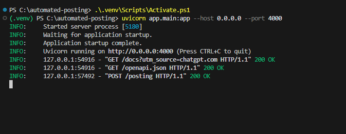

---

### 2. Swagger UI Overview
Interactive FastAPI documentation interface showing the available `/posting` endpoint.

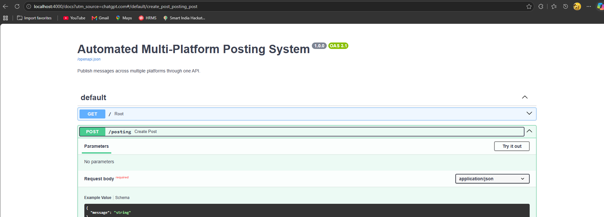

---

### 3. Endpoint Details & Parameter Specification
Expanded view of `POST /posting` showing request body and parameter specifications.

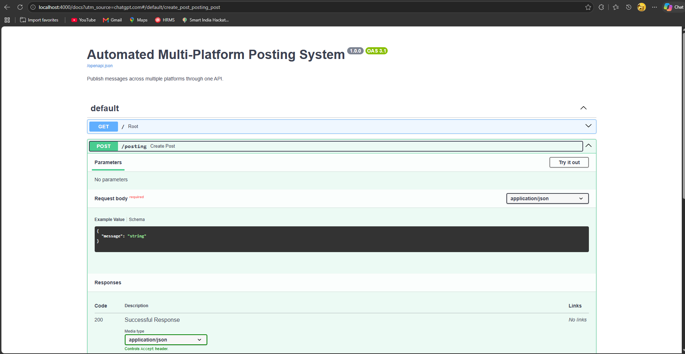

---

### 4. Executing Request in Swagger UI
Executing a live test request with the required message format and link.

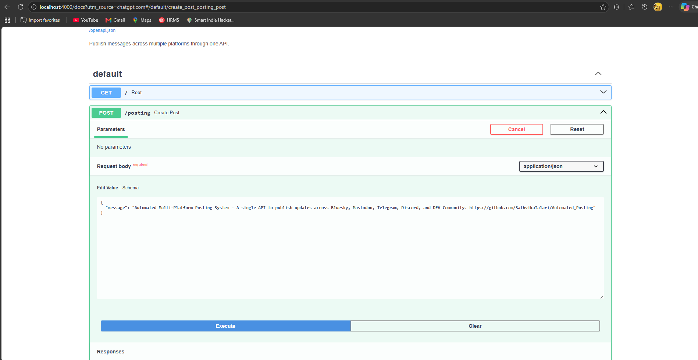

---

### 5. API Response – Part 1 (Bluesky & Mastodon)
Successful `200 OK` response with `status: "completed"`, `total_platforms: 5`, `successful: 5`, `failed: 0`, showing generated live post URLs for Bluesky and Mastodon.

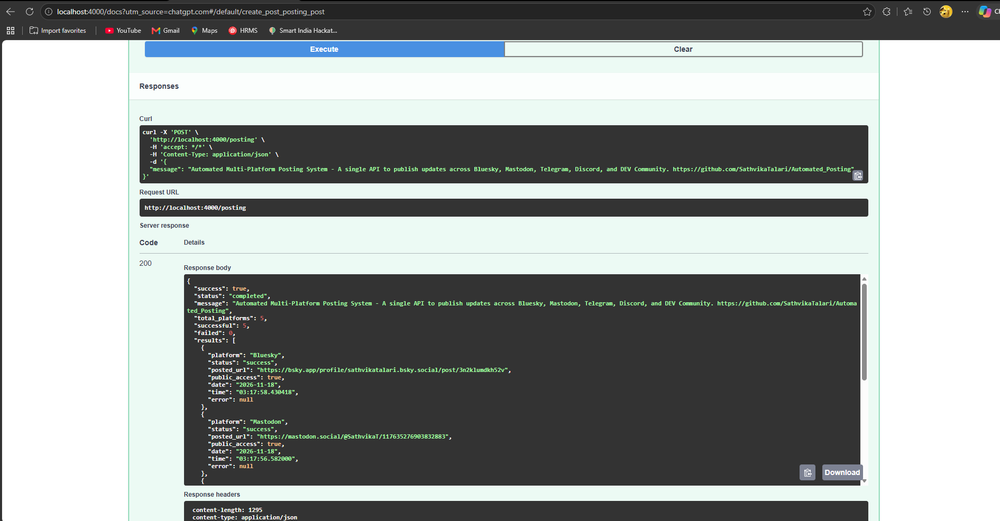

---

### 6. API Response – Part 2 (Telegram, Discord & DEV Community)
Generated live post URLs and timestamps for Telegram, Discord, and DEV Community.

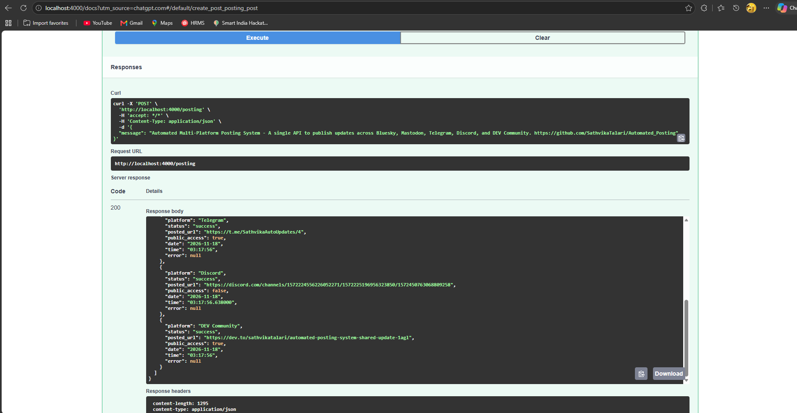

---

### 7. Response Schema & Validation Error Definitions
Response schemas and validation error formats (`HTTP 422`).

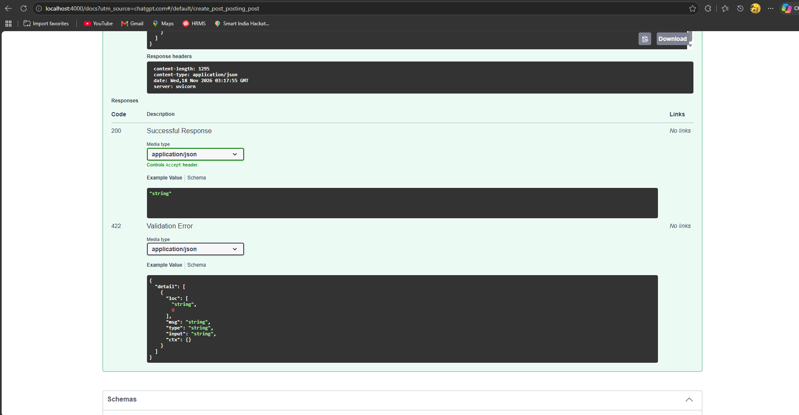

---

### Live Published Posts on Third-Party Platforms

Below are the live, publicly accessible and direct posted updates across all 5 integrated platforms resulting from the single API request:

#### 1. Bluesky
Live post on Bluesky profile (`sathvikatalari.bsky.social`) with rich link metadata and click-through URL:

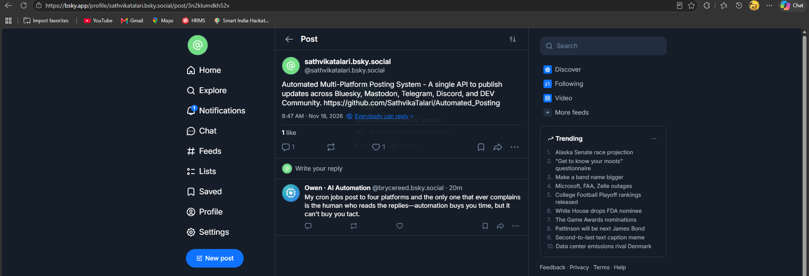

---

#### 2. Mastodon
Live public toot on Mastodon instance (`mastodon.social/@SathvikaT`) displaying message content and GitHub preview card:

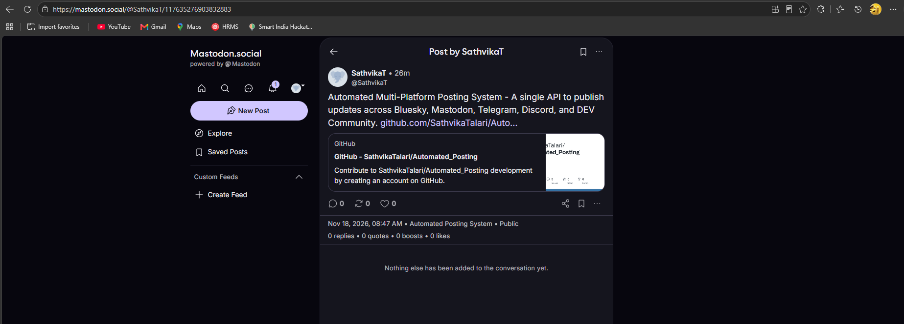

---

#### 3. Telegram
Message delivered live to the public broadcast channel (`t.me/SathvikaAutoUpdates`) with automatic link preview:

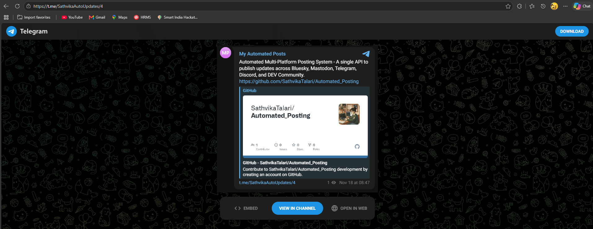

---

#### 4. Discord
Message published via Discord Webhook into the dedicated `#automated-posting-system` channel with instant preview card:

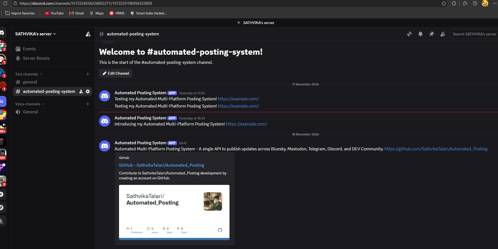

---

#### 5. DEV Community
Article created and published live on DEV Community (`dev.to/sathvikatalari`) using the Articles API:

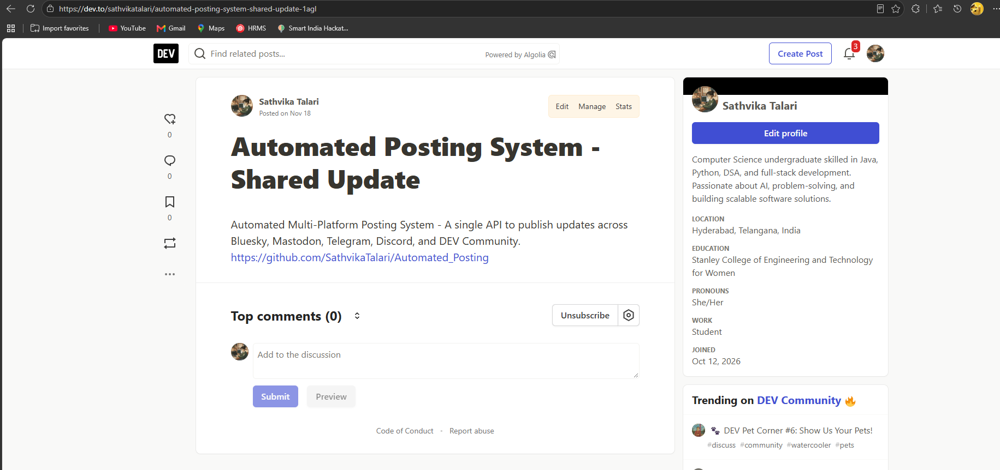

## Validation Rules

- Message must not be empty.
- Message must not exceed 200 characters.
- Exactly one HTTP/HTTPS URL must be included.
- Invalid requests receive an HTTP 422 validation response.

## Error Handling

Each platform is processed independently. A failure on one platform does not prevent publishing to the remaining platforms.

The API returns individual success or failure information for every platform.

## Running Tests

Run the complete test suite:

```bash
python -m pytest -v
```

Tests cover:

- Request validation.
- Partial and complete publishing failures.
- Successful platform publishing.
- Platform authentication failures.
- Mocked API responses without creating real posts.

## Security

- Credentials are loaded from environment variables.
- `.env` is excluded from version control.
- Error responses avoid exposing raw exception details.
- Use platform-specific tokens and app passwords.

## Author

**Sathvika Talari**

GitHub: https://github.com/SathvikaTalari

LinkedIn: https://www.linkedin.com/in/sathvika-talari-033093308/
